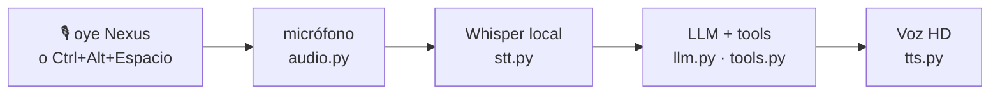

# ✦ NEXUS — tu asistente en Windows 10

(**Nació como J.A.R.V.I.S.**; v14 lo renombró NEXUS; v21 le puso NEXO de apodo; **v28 lo dejó como NEXUS para siempre** — y **v30 le devolvió su pastilla** con carga instantánea del menú; **v31 la centró**; **v32 la alargó**; **v33 copió la interfaz del Troko EXACTA**; **v34 le quitó la boca a la carita, la redondeó y metió la isla en el menú**.)

Wake word **«oye Nexus»** (con tu acento de siempre) o hotkey **Ctrl+Alt+Espacio** → Whisper te entiende (100% local) → LLM piensa → herramientas actúan sobre tu PC → voz responde.



## 📌 Lo nuevo en v34 (SIN BOCA + EL MENÚ REEMPLAZA LA BARRA)

- **La carita ya NO tiene boca**: lo expresa TODO con los ojos — cápsulas pastillosas con chispa, `^^` feliz al completar, línea al dormir, y **respiración** en idle.
- **Carita menos alta** (bien acomodada dentro de la pastilla) y **esquinas redondeadas otra vez**: la pastilla es una **cápsula** negra pura.
- **El notch es menos ancho** (280 px en idle) — sigue siendo una pastilla larga.
- **El menú REEMPLAZA la barra**: al abrirse, la isla se colapsa y el panel crece desde el borde superior — ya no cuelga debajo de la banda.
- **La pastilla animada también vive en el menú**: debajo del logo N E X U S del sidebar está la **isla en miniatura**, con la misma carita que respira, parpadea, waves, puntitos y crono en tiempo real.

## 📌 Lo nuevo en v33 (LA INTERFAZ TROKO EXACTA)

- **La pastilla es la de Troko de verdad**: RECTÁNGULO largo y RECTO (350-480 px de ancho, 4-5× más largo que alto), negra pura — **SIN sombra, SIN filos de cristal, SIN reflejo** (fuera el "coso gris").
- **Carita GRANDE a la izquierda** (~1/3 de la pastilla): ojos CÁPSULA pastillosos con chispa, **BOCA sonriente siempre**, rubor feliz, mirada y **RESPIRACIÓN en idle** (sube y baja suavecito).
- **Animaciones ×1.7 más fluidas** (fase, ancho y despliegue más rápidos).
- **Al abrir el menú el notch DESAPARECE del todo** (nada de banda negra ni wordmark: solo el panel flotante).
- **El menú es el de Troko EXACTO** (image-32): sidebar con **icono + TEXTO** ("Inicio", "Chat"...), fila activa **#2D2D2D** con texto blanco, inactivos **#A0A0A0**, logo arriba + "● listo", fondo **#121212**, tarjetas **#1E1E1E con borde #333333**, panel **flotante redondeado** (4 esquinas, r18), ventana **800×480**.

## 📌 Lo nuevo en v32 (LA PASTILLA LARGA + EL VERDE DEL TROKO)

- **MÁS LARGA**: la pastilla ganó ancho en todos sus estados
  (reposo 250, escucha 330, piensa 270, enfoque 300…).
- **SIN la cosa gris**: se quitó el filo de contorno que se veía
  como una marca gris alrededor — la pastilla volvió a ser negra
  limpia, como siempre.
- **EL NOTCH DESAPARECE al abrir el menú**: como pediste — al
  desplegar el panel, la isla se esfuma en la banda negra.
- **EL VERDE DEL TROKO**: el color de acento del menú ahora es el
  verde CLARO del Troko (#8BC34A): el icono activo del sidebar se
  rellena de ese verde con el icono oscuro, igual que la interfaz
  que copiamos.
- **CARGA MÁS RÁPIDA**: el precalentamiento del menú pasa de 900 ms
  a 250 ms — casi todo está listo antes de que hagas hover.
- **Troko exacto**: input «Escribe o habla con NEXUS…», título de
  sección más grande, subtítulos del Troko («Tus pendientes de
  hoy», «Tu progreso de hoy»), y el cronómetro del enfoque GRANDE
  (24pt) protagonista, como en Troko.

## 📌 Lo nuevo en v31 (LA PASTILLA CENTRADA Y SIEMPRE VISIBLE)

- **CENTRADA**: la pastilla ya no vive pegada a la izquierda de la
  ventana — se dibuja SIEMPRE en el centro de la pantalla.
- **NADIE LA TAPA**: al abrir el menú la pastilla SIGUE VIVA encima de
  la banda negra (carita + dot verde + parpadeo + mirada); antes se
  esfumaba en cuanto el panel desplegaba.
- **MÁS PASTILLA, MENOS CÍRCULO**: la carita ahora es una pastilla
  crema (rectángulo redondeado horizontal), no un óvalo flotante — y
  la pastilla ganó un filo de contorno que la hace visible incluso
  sobre fondos negros.
- **CRONO GRANDE**: «▸ 24:59» pasó de 7.5pt a 10.5pt — ya se lee.
- Todo lo demás de v30 intacto: carga instantánea del menú, caché de
  render, bordes suaves, burbujas del chat redondeadas.

## 📌 Lo nuevo en v30 (LA PASTILLA VUELVE + CARGA INSTANTÁNEA)

- **VOLVIÓ LA PASTILLA**: la isla negra de siempre con su carita crema,
  ojos que te siguen y parpadean, dot verde ONLINE a la derecha y las
  waves/puntitos/crono al centro — con 3 filos de cristal y sombra.
- **ARREGLO DE RENDIMIENTO**: el render HQ ahora tiene CACHÉ (solo
  re-dibuja si algo cambió de verdad) y el panel construye sus
  secciones LAZY + precalentado invisible → **el menú abre instantáneo
  y sin bugs de widgets amontonados** (v29 construía todo en el primer
  hover: esa era la demora).
- **Losa del panel con bordes SUAVES de verdad** (Pillow 2× + LANCZOS)
  y **burbujas del chat redondeadas** de verdad, no cuadradas.
- Todo lo demás igual: chat, correo, GitHub push, focus, hábitos,
  wake «yarvis» / «nexus», iconos HQ del sidebar Troko Desk.

## 📌 Lo nuevo en v29 (EL CUBITO EMO + PANEL TROKO DESK)

- **El cubito**: la pastilla se convirtió en un **cuadrito negro con ojos
  cápsula y chispa de luz** (inspirado en el robot Emo) que flota a la
  izquierda. Sus ojos siguen la mirada, parpadean, se ponen verdes cuando
  te escucha, se ponen ^^ cuando está feliz y se cierran cuando duerme.
- **El chip de estado** (waves, puntitos, crono, avisos) aparece flotando
  a la derecha del cubito — separado, como pediste.
- **El panel es el Troko Desk de verdad**: sidebar izquierda con
  **iconos de IMAGEN de verdad** (renderizados con Pillow, no puntos),
  el activo se llena de verde; tarjetas `#1E1E1E` sobre NEGRO PURO —
  el mismo color del notch, así que el panel empieza donde estaba el
  notch, sin costura.
- **El cubito es el avatar**: al abrir el panel NO se mueve — queda
  encima de los menús, a la izquierda (como el logo del Troko).
- **Secciones espaciosas** con título + subtítulo (estilo Troko),
  **barra de PROGRESO en tareas** (X de Y · %) y un **gráfico de
  barras** en Inicio (pendientes / hechas hoy / hábitos).
- Todo lo de v28 sigue: chat con burbujas (voz y texto), correo con
  diálogo para escribir la dirección, GitHub push con las credenciales
  de GitHub Desktop, wake «yarvis».
- 60 fps, render HQ 3× con LANCZOS, hover para abrir/cerrar.

## 📌 Lo nuevo en v28 (NEXUS + CHAT + CORREO + GITHUB)
- **Se llama NEXUS otra vez** (el NEXO se retira). Y puedes decirle **«yarvis»** — jarvis en español, sin acento gringo — junto a «nexus», «nexo» y «hey jarvis»: el oído reconoce las tres formas.
- **Animaciones 60 fps**: el doble de frames, pasos de animación más chicos y ease-out — el notch y el panel se mueven sedoso de verdad.
- **El notch estilo Troko**: la carita a la **izquierda**, el **dot verde a la derecha, bien separado**, y la pastilla con filos de cristal arriba, reflejo glossy y hairline abajo.
- **Menú de botones CIRCULARES** como el Troko: el activo se llena de verde.
- **Vista de CHAT nueva**: burbujas como las del Troko (tú en verde, NEXUS en tarjeta). Lo que le hablas POR VOZ también queda en el chat, y lo que escribes contesta en voz alta.
- **CORREO ✉️**: dile «envía un correo» + lo que dice → se abre un **diálogo** para escribir la dirección (dictarla falla), editar el texto y enviar. Requiere Gmail con verificación en 2 pasos + contraseña de aplicación en `config.py` (instrucciones arriba de la sección de correo).
- **GITHUB 🚀**: dile «en esta carpeta hice cambios, haz commit y push al repo X» → commit de todo + push usando las credenciales que GitHub Desktop ya guardó en Windows.
- Todo sigue **100% local** (el correo y el push son las únicas cosas que salen a internet, cuando tú las pides).

## 📌 Lo nuevo en v27 (NOTCH PREMIUM + PREGUNTAS)
- **El notch vuelve a casa**: orbe gato fuera, pastilla otra vez — pero **premium**, no plana: sombra suave debajo, **hairline de luz arriba** (filo de cristal), carita crema con **reflejo glossy** translúcido y ojos con **chispa de luz** (glossy, alpha 60 en HQ). Complejidad sin formas simples.
- **Pegado arriba**: el menú abre justo donde estaba el notch, en la barra superior de siempre (700×280, ventana de tamaño fijo, 30 fps).
- **El campo de preguntas AHORA FUNCIONA**: escribe lo que sea en «Pregúntale algo a NEXO…», Enter, y NEXO **piensa y contesta EN VOZ ALTA** — mismo cerebro (llm.respond) y misma voz (tts.speak) que si le hablaras. Placeholder gris que desaparece al tocar, aviso «💬 Ya voy…» y «💬 Respondido».
- Se conserva lo bueno de v26: saludo dinámico, chip **100% LOCAL**, stats con dot de color + halo, dos columnas de tareas, tarjetas con sombras de 2 capas y anillo con glow verde.
- Todo sigue **100% local** en tu PC.

## 📌 Lo nuevo en v26 (EL ORBE GATO — 2026, no 2005)
- **Adiós pastilla**: NEXO ahora es un **orbe squircle** (cuadrado redondeado, como los iconos de app) con **orejitas de gato** 🐈‍⬛ — un guiño al gato de Mistral — flotando con **sombra suave** debajo y un **halo que respira** (late más rápido cuando te escucha).
- **Chips flotantes**: el crono, los avisos, las waves y los puntitos ya no viven dentro de la pastilla: cada estado es un **chip flotante** que aparece al lado del orbe con su propia sombra y hairline de luz. En reposo queda SOLO el gato con su LED verde «online» — minimal.
- **Ojos y orejas con vida**: las orejitas se mueven con la mirada, el gato cierra los ojos al dormir y el rubor 💗 al celebrar.
- **Panel 2026**: saludo dinámico («Buenos días/tardes/noches» ☀️🌤️🌙), chip **100% LOCAL** en el header, y stats con **dot de color + halo** y números en Consolas.
- Todo sigue a 30 fps, ventana de tamaño fijo (sin fantasmas) y **100% local** en tu PC.

## 📌 Lo nuevo en v25 (OÍDO SENSIBLE + PANEL ANCHO FUTURISTA)
- **FIX «no me detecta la voz»**: el wake por Whisper es **4× más sensible**. Antes exigía voz fuerte en el chunk exacto y revisaba cada 1 s; ahora usa un **pico de voz decayente** (basta hablar UNA vez en ~1 s), dispara con el 25% del umbral, revisa cada **0.7 s** con una ventana de **3 s**, y el match es **difuso**: si Whisper escribe «next» o «javis», entiende «nexo» y «jarvis» (la raíz suena igual). Si dices algo y no matchea, la consola muestra «🤏 Casi: te oí …» para que calibres.
- **Panel ANCHO y pegado arriba** (700×280): ya no media pantalla. Dos columnas de tareas, tarjetas con **sombras de verdad** (dos capas + hairline de luz arriba), anillo de enfoque con **glow verde**, header compacto con el chip del hotkey, y textos nuevos por todo lado.
- **Isla con sombra suave** debajo del pill y animación a **30 fps** con easing (más sedosa).
- `py -3.12 diagnostico.py` te dice qué micro usa Windows y qué tanto te oye, por si algo sigue raro.

## 📌 Lo nuevo en v24.1 (FIX: oído muerto + isla fantasma)
- **FIX «no escucha nada»**: al quitar el `with stream:` de v24 se perdió el arranque del micrófono — el stream se creaba pero **nunca arrancaba** (`stream.start()`), así que no llegaba audio jamás. Ahora arranca siempre, y si el micro se queda mudo, `record_command` suelta a los 3 s (antes se colgaba en bucle infinito).
- **FIX «transparente y demora en aparecer»**: la ventana se redimensionaba 25 veces por segundo con transparencia (carísimo en Windows → fantasma lento). Ahora la ventana es de **tamaño fijo** (la parte invisible es transparente y no estorba) y el panel se despliega **por dentro**, fluido y sin parpadeos.
- **FIX «aparece debajo»**: el pill del panel quedaba despegado de la isla por un filito. Ahora va **soldado a la barra** (y=0), como un solo cuerpo.
- **Más fluido**: las fuentes del render HQ ahora van en **caché** (leer el .ttf cada frame era lento) y la imagen Tk se **reutiliza** en vez de crear una nueva por frame.

## 📌 Lo nuevo en v24 (ISLA CHIQUITA + RENDER HQ + PANEL DESDE LA ISLA)
- **Render ANTIALIAS de verdad**: Tk no suaviza bordes (por eso se veía pixelado). Ahora la isla se dibuja **3× más grande con Pillow** y se reduce con LANCZOS → cero dientes de sierra, sin assets externos. Si Pillow no está, cae al modo vectorial de siempre y no muere.
- **Isla más chiquita**: 34 px de alto (antes 40) y pill más corto (idle 190 · escuchando 258 · pensando 214 · enfoque 240 · aviso 300 · dormido 205).
- **El panel se despliega AHÍ MISMO**: la carita se esfuma un momento y la ventana CRECE desde el borde (como `.island[data-open]` de la web), ya no es una ventana aparte. Se pliega sola al sacar el cursor o hacer clic afuera.
- **🗑 Borrar hábitos**: botón en cada fila del panel y también por voz («borra el hábito agua») → herramienta `delete_habit`, con **deshacer** por si te arrepientes.
- **FIX «funcionó solo una vez»**: el hilo del oído moría en silencio (una excepción o un micro callado mataban la espera del wake). Ahora los chunks se leen con timeout, el stream se reinicia solo si el micro se queda callado, todo va blindado con try/except y el pipeline ya NO muere: si algo revienta, se levanta en 2 s.

## 📌 Lo nuevo en v23 (ISLA estilo web + HOVER + Fish Audio)
- **La isla ahora es IGUALITA a la web interactiva**: el ancho del pill cambia según el estado (idle 236 · escuchando 320 · pensando 268 · enfoque 300 · éxito 292 · aviso 380 · dormido 256), con la **carita CREMA de ojos oscuros** (la del Troko real) en el centro.
- **Slots a los lados como en la web**: `waves ▁▃▅▃▁` al escuchar, puntitos al pensar, `▸ 24:59` en el enfoque, el dot verde, los avisos («✓ Anotado») y «z Z z» al descansar. Feliz = arcos ^ ^ con rubor 💗.
- **HOVER mágico**: pasa el cursor por la isla y **el panel se abre SOLO**; saca el cursor (o haz clic afuera) y **se cierra solito**. El clic en la isla sigue alternando, con 3 s de gracia para que no se reabra de una.
- **El panel se vistió de web**: paleta `--panel/--card/--cream/--lime`, tabs transparentes con la activa en verde tenue, badges pastilla, field con **mic circular verde**, stats con cuadritos de color, filas de tareas con hairlines y checks redonditos, hábitos con **drops de agua azules** 🔵, y kinds de enfoque en pills.
- **Micro MÁS sensible**: nueva clave `MIC_SENSIBILIDAD = 1.7` en config.py — baja el umbral de voz (~150→~88), el del wake word (0.55→0.32) y el de tu orden, TODO multiplicado. `2.5` = oye hasta susurros.
- **Voz FISH AUDIO**: pega tu API key de fish.audio en `FISH_API_KEY` y NEXO habla con la voz `21adf3cda02a4aa88dc593353cc9d715` (la que elegiste, español sin filtros). Si Fish falla o no hay key, cae a edge-tts solo.

## 📌 Lo nuevo en v22.1 (NOTCH NEGRO, bien dibujado)
- **Arreglado el notch «volteado»**: la pastilla es **negra pura**, **plana arriba** (pegada al borde, como el notch de un iPhone) y con las esquinas **redondeadas abajo de verdad** — los arcos se calculan punto por punto (antes el suavizado curvaba también el borde de arriba y se veía girada).
- **Cero verde**: sin borde verde, y los avisos/crono de la isla ahora en **blanco**.

## 📌 Lo nuevo en v22 (NOTCH iPHONE + ojos del Troko real)
- **Notch estilo iPhone**: pastilla **168×40 px** **pegada al borde superior** (sin espacio), plana arriba y redondeada abajo.
- **Los ojos del Troko Desk real**: escleróticas **blancas** (cápsulas) con **pupilas negras** que siguen tu mouse; entrecerrados = media luna, cerrados = línea —, felices = arco ^^, guiño, alerta. Sobre fondo negro, como en la isla de Troko.
- Todo lo demás intacto: panel, tareas, hábitos, enfoque, avisos, crono y voz (v21).

## 📌 Lo nuevo en v21 (NEXO, bonito de verdad)
- **Nuevo nombre fácil: NEXO** (né-so). Le seguís hablando igual («oye nexus», «nexo», «jarvis») — solo cambió la etiqueta.
- **Mini notch**: la isla ahora es **148×40 px**, chiquita como el borde de una ventana, pegada arriba y al centro. Ojitos mini que siguen tu mouse, parpadean, guiñan y celebran; avisos y cuenta atrás **al lado de los ojos**, alineados a la derecha.
- **Panel rediseñado estilo Troko real**: tarjetas redondeadas con borde sutil, botones con hover, chips verdes con contadores, barra lateral con iconos, tipografía Segoe UI y paleta negro-verdosa moderna.
- **Hábitos con barra de progreso**: cada hábito muestra su avance (pista + relleno verde) y su racha 🔥.
- **Enfoque con anillo**: cuenta atrás circular estilo app moderna, con el tiempo al centro; se vacía mientras trabajás.
- Inicio con tarjeta de saludo (fecha en español), resumen del día y el gran botón verde **🎙 Escúchame**.
- Todo sigue conectado con la voz: mismas herramientas, mismos datos, mismos avisos en el notch.

## 📌 Lo nuevo en v20 (EL PANEL, como el Troko real)
- **Clic en la isla → se abre el PANEL DE CONTROLES** (`panel.py`), estilo Troko Desk: ventana flotante negra con verde Matrix y **barra lateral** 🏠 Inicio · 📋 Tareas · 💧 Hábitos · ⏳ Enfoque. **Esc** o ✕ la cierra; otro clic en la isla la alterna.
- **Inicio**: saludo con fecha en español, resumen de tu día (tareas y hábitos) y botón **🎙 Escúchame** (además del hotkey Ctrl+Alt+Espacio).
- **Tareas**: lista con botón ✓ para completar, campo para añadir y contador de hechas hoy.
- **Hábitos**: progreso hecho/meta, racha 🔥 y botón +1; se crean desde el panel («nombre : meta»).
- **Enfoque**: botones de 5/15/25/50 min, la cuenta atrás en grande y botón Parar.
- **Todo conectado con la voz**: el panel usa las MISMAS herramientas (tools.py) — lo que haces con el mouse lo sabe NEXUS y lo que le dices por voz se refleja en el panel. Los avisos siguen apareciendo en la isla.
- **Isla más pequeña** (140×106) y bien pegada arriba, como el notch de Troko.

## 📌 Lo nuevo en v19 (MODO TROKO: tareas, hábitos y enfoque)
NEXUS ahora cubre lo que hace un asistente de escritorio comercial — y más:
- **Tareas**: «anota una tarea estudiar para el parcial» / «qué tengo pendiente» / «ya hice la primera». Se guardan en `nexus_tareas.json` (deshacer funciona).
- **Hábitos con rachas**: «créa el hábito agua con meta 8» / «tomé agua» / «cómo van mis hábitos». Cuenta tu racha de días seguidos y **celebra cuando llegás a la meta** (ojitos felices ^ ^ + «🎉 ¡Meta cumplida!» en la isla).
- **Enfoque / temporizador**: «enfoque 25 minutos» o «temporizador de 5» → la cuenta atrás se ve en la isla («▸ 24:59») y al terminar NEXUS suena y te lo dice en voz alta. «cancela el temporizador» lo corta.
- **La isla te avisa**: cada acción muestra un aviso bajo los ojitos («✓ Anotado», «✓ Hecho», «⏰ Recordatorio») — como la isla de Troko.
- **Los ojitos siguen tu mouse** 🖱️ — si movés el cursor, te miran; si te quietas, curiosean solos. Y de vez en cuando **te guiñan** en espera.
- **Parte del mañana ampliado**: ahora te dice cuántas tareas pendientes y hábitos cumplidos tenés hoy.
- **32 herramientas** en total. Todo gratis, todo local, todo tuyo.

## 📌 Lo nuevo en v18 (SOLO OJITOS, como el video de Troko)
- **La cara es solo la cara**: afuera el título, el "EN ESPERA", los subtítulos, el log, los brackets y la telemetría — ahora NEXUS es **una pastilla negra redondeada y pequeña (172×148) con los dos ojitos reactivos y NADA más**, flotando arriba y al centro, estilo Troko Desk.
- **La expresión es el estado**: dormidos ∪∪ arrancando, parpadeo y mirada curiosa en espera, bien abiertos escuchando, entrecerrados pensando, felices ^ ^ hablando.
- **Arrastrable**: agarras la pastilla y la pones donde quieras.
- **Clic en los ojitos** = "escúchame ahora" (sigue igual).
- Esquinas redondeadas de verdad y halo suave que respira. Todo lo demás (wake natural, modo CLI, ojos para ver tu pantalla) intacto.

## 📌 Lo nuevo en v17 (OJITOS estilo Troko)
- **NEXUS ahora tiene cara**: el icosaedro 3D se jubiló — en su centro hay **dos ojitos redonditos SIEMPRE visibles** que dan personalidad:
  - 😴 **Arrancando**: ojitos dormidos (curvitas ∪ ∪)
  - 🙂 **En espera**: medio abiertos, **parpadean solos** cada rato y la **mirada deambula** curioseando la pantalla
  - 👀 **Escuchando**: BIEN abiertos, verde brillante, con brillocito de luz
  - 🤔 **Pensando**: entrecerrados mirando hacia arriba (clásico "déjame pensar…")
  - 😄 **Hablando**: ojitos felices ^ ^ que rebotan con la voz
- **Clic en los ojitos** = "escúchame ahora" (despierta sin wake word).
- **Panel bonito estilo app moderna**: esquinas redondeadas de verdad (color transparente de Windows), halo que respira detrás de la cara, anillo de marquitas sutil, mini-terminal de log integrada en el panel.
- Nueva identidad: **MK-XVII**.

## 📌 Lo nuevo en v16 (LOS OJOS)
- **NEXUS ve tu pantalla**: di **«mira mi pantalla»**, **«mira lo que estoy haciendo»**, **«qué error ves»** → captura la pantalla (todos los monitores), te la manda al cerebro **como imagen** y el modelo con visión la describe y **actúa** (abrir lo que falta, arreglar lo que ve, repetir lo que estás haciendo).
- **Auto-defensa del cerebro**: si tu modelo no soporta imágenes (p. ej. DeepSeek), no revienta — reintenta sin la imagen y te avisa que cambies a uno con visión (`mistral-small-latest` o superior la ve).
- **Limpieza**: cada captura borra la anterior — Temp no se llena de screenshots.
- Nueva dependencia: `py -3.12 -m pip install Pillow` (ya está en requirements.txt).
- **24 herramientas** en total.

## 📌 Lo nuevo en v15 (Matrix + modo CLI)
- **Verde Matrix**: fondo negro (#020806), verdes neón (#4dff96 / #2fbf71), panel más compacto (360×430) — cero azul, estilo terminal.
- **Modo CLI — 5 herramientas nuevas (23 en total)**: NEXUS ya no solo habla, también **programa**:
  - **create_code**: «créame un script que …» → escribe el archivo en el Escritorio y lo abre (python, js, html, batch, c…). Deshacer lo borra.
  - **run_python**: «ejecuta esto: print(2**10)» → corre el código real en tu PC y te lee la salida (guarda los scripts en `nexus_scripts`, 25 s máx). *Ojo: ejecuta lo que le pidas — es tu PC, tú mandas.*
  - **read_file**: «lee config.py» → devuelve el contenido para resumirlo o explicarlo.
  - **calculate**: «¿cuánto es 1250 menos 320 por 19%?» → cálculo EXACTO (AST seguro, con sqrt/pi/…), nunca a ojo.
  - **list_files**: «¿qué hay en descargas?» → lista la carpeta con 📁/📄.
- **Respuestas más largas cuando toca**: historias, explicaciones y código ya no se cortan a 3 frases (max_tokens 800) — pero sigue prohibido el markdown: todo se habla.
- **Wake multi-comando**: `WAKE_FRASES = ["nexus", "nexo", "jarvis"]` con matching por substring → «nexus», «hey nexus», «oye nexus», «oe nexus», «ey nexus», «nexo» y hasta «hey jarvis» (legacy) todos despiertan.

## 📌 Lo nuevo en v14 (NEXUS)
- **Wake natural**: di «oye Nexus» como hablas siempre — Whisper 'tiny' escucha y entiende tu acento (`WAKE_MODE` en config: `ambos` por defecto; el gringo "hey Jarvis" también sigue funcionando).
- **Notch estilo Troko Desk**: arranca como pastilla arriba al centro de la pantalla; clic la expande con animación al panel completo con el orbe 3D.
- **Interactivo**: clic en el orbe = «escúchame ahora» (despierta sin wake word). Punto de color = estado (gris esperando, verde escuchando, ámbar pensando, azul hablando).
- **Hotkey global**: Ctrl+Alt+Espacio despierta a NEXUS desde cualquier app o juego (`py -3.12 -m pip install keyboard`).
- **Deshacer**: di «deshaz eso» — revierte documentos, notas, recuerdos, organización del escritorio, volumen y recordatorios (una acción por llamada).
- **Cerebro blindado**: los modelos grandes a veces devuelven la respuesta en bloques — v14 lo normaliza (adiós al error `'list' object has no attribute 'strip'`).
- **Sin transcripción en pantalla**: lo que dices solo va a la consola (`SHOW_TRANSCRIPT = True` si quieres verlo en el panel).

## 📦 Instalación (unos 15-30 min)

> ⚠️ **Importante: usa Python 3.12 (recomendado) o 3.13 — NO 3.14.** Con 3.14 la instalación falla porque pygame y otras librerías del stack todavía no publican binarios compatibles y pip intenta compilarlas desde cero. Descarga Python 3.12 de [python.org/downloads](https://www.python.org/downloads/) (baja hasta "Looking for a specific release" → 3.12.x). No hace falta desinstalar tu 3.14.

1. **Python 3.12**: descárgalo de [python.org](https://www.python.org/downloads/). Al instalar, **marca "Add Python to PATH"** (esto es clave). Windows convive con varios Pythons sin problema: el instalador incluye el lanzador `py`.
2. Abre la **cmd** en esta carpeta (en el Explorador: escribe `cmd` en la barra de direcciones) y ejecuta **con Python 3.12**:
   ```
   py -3.12 -m pip install -r requirements.txt
   ```
   *(la primera vez tarda: descarga Whisper "small" ~460 MB y los modelos de wake word ~30 MB)*
   Si `py -3.12` no existe (no instalaste 3.12), usa `python` — pero ojo, apunta a tu 3.14 y fallará.
3. **Elige el cerebro** — edita `config.py`:

| `PROVIDER =` | Plata | Dónde consigo la key | Modelo por defecto |
|---|---|---|---|
| `"mistral"` ⭐ | **Gratis** (tier con límites de uso) | [console.mistral.ai](https://console.mistral.ai/) | `mistral-small-latest` |
| `"groq"` | **Gratis** (tier gratuito) | [console.groq.com/keys](https://console.groq.com/keys) | `llama-3.3-70b-versatile` |
| `"openai"` | **De pago** (~$0.15 USD / millón de tokens de entrada con GPT-4o mini; requiere tarjeta internacional y saldo) | [platform.openai.com](https://platform.openai.com/api-keys) | `gpt-4o-mini` |
| `"ollama"` | Gratis y **sin internet** (corre en tu PC; lento en CPU, necesitas 8+ GB RAM libres) | [ollama.com](https://ollama.com) — luego `ollama pull qwen2.5:7b-instruct` | `qwen2.5:7b-instruct` |

   Pega tu API key en `config.py` (`LLM_API_KEY`). No la compartas con nadie.

4. Ejecuta Jarvis:
   ```
   py -3.12 main.py
   ```
   ...o doble clic en `run.bat` (ya intenta usar 3.12 solo).

## 🖥 La interfaz (v11)

`py -3.12 main.py` abre una ventana con la **esfera arc-reactor de Jarvis** en tu tema Blue Mocha Dark:

- **Respira** lenta en espera y **se agita** cuando habla, gira más rápido cuando piensa y pulsa cuando te escucha.
- Debajo: **subtítulos** en vivo (lo que dijiste + lo que responde) y un **registro** de la conversación.
- La esfera refleja el estado: `EN ESPERA` → `ESCUCHANDO` → `PROCESANDO` → `RESPONDIENDO`.
- Modo consola clásico: `py -3.12 main.py --cli`. Probar el oído: `--diagnostico`.

## 🗣 Qué puedes decirle

> El wake word ya no es "hey Jarvis": di **«nexus»**, **«hey nexus»**, **«oye nexus»** o **«oe nexus»** (también «jarvis» legacy).

- "**¿cómo va el equipo?**" → CPU, RAM, disco y batería
- "**organiza mi escritorio**" / "**deshaz eso**"
- "**ponte volumen al 40%**"
- "**ábreme Chrome / VS Code / Spotify / Minecraft**"
- "**pon música de lofi en YouTube**" / "**pon una canción al azar de mi carpeta canciones**"
- "**recuérdame apagar la impresora a las 20:30**" *(hora formato 24h: "2026-11-13 20:30" — el cerebro la convierte)*
- "**toma nota: la fórmula es gramos por 75 por 3**"
- "**créame un script que renombre mis fotos**" → lo escribe en el Escritorio y lo abre *(v15)*
- "**ejecuta este código: print(2 elevado a 10)**" → lo corre y te lee la salida *(v15)*
- "**lee el archivo tarea.txt**" → te lo resume o explica *(v15)*
- "**¿cuánto es 1250 menos 320 por 19%?**" → cálculo exacto *(v15)*
- "**¿qué hay en descargas?**" → lista la carpeta *(v15)*
- "**mira mi pantalla** / **mira lo que estoy haciendo** / **qué error ves**" → captura y VE tu pantalla, luego actúa *(v16)*
- "**anota una tarea X** / **qué tengo pendiente** / **ya hice X**" → tu lista de tareas *(v19)*
- "**créa el hábito agua con meta 8** / **tomé agua** / **cómo van mis hábitos**" → hábitos con rachas *(v19)*
- "**enfoque 25 minutos** / **temporizador de 5 minutos** / **cancela el temporizador**" → enfoque con cuenta atrás en la isla *(v19)*
- **Clic en la isla** → abre el **panel de controles** (tareas, hábitos, enfoque) *(v20)*
- "**recuerda que mi impresora es la Ender 3 S1 Plus**" → memoria duradera
- "**cuéntame un chiste**" *(los responde de su propio conocimiento, sin buscar)*
- "**muéstrame el escritorio**" *(como Win+D)*
- "**¿qué hora es? / ¿qué día es hoy?**"
- "**busca cómo calibrar la Ender 3**" *(busca en silencio y te resume; "ábreme Google y busca X" abre el navegador)*

## 🌅 El parte del mañana (briefing)

Jarvis te resume el día en una sola hablada: saludo, fecha, hora, **clima de Medellín** (vía wttr.in, gratis) y estado de tu equipo.

- **Manual:** `python main.py --briefing`
- **Automático cada día** (Programador de tareas de Windows, ej. 7:00 a.m.):
  ```
  schtasks /create /tn "Jarvis Briefing" /tr "py -3.12 C:\RUTA\A\jarvis-pc\main.py --briefing" /sc daily /st 07:00
  ```
  *(cambia `C:\RUTA\A\jarvis-pc` por la carpeta real)*

## 🧠 Cómo funciona, por niveles

| Nivel | Archivo | Qué hace |
|---|---|---|
| 1 | `config.py` | TODAS las opciones en un solo sitio: proveedor del cerebro, voz, umbrales. |
| 2 | `audio.py` | Micrófono: detecta "hey Jarvis" (openWakeWord) y graba tu orden hasta que callas. |
| 3 | `stt.py` | Convierte tu voz a texto con Whisper corriendo **en tu CPU** (no gasta internet). |
| 4 | `llm.py` | El cerebro, multi-proveedor (Mistral/Groq/OpenAI/Ollama, misma API). Decide si usar herramientas. |
| 5 | `tools.py` | Las manos: funciones reales sobre Windows (apps, escritorio, volumen, notas...). |
| 6 | `tts.py` | La boca: voz neuronal `es-CO` de Microsoft vía edge-tts. |
| 7 | `briefing.py` | El parte del mañana: día + clima + estado del equipo. |
| — | `main.py` | El lazo que une todo el pipeline. |

## 🔧 Agregar una herramienta nueva (2 pasos)

1. En `tools.py`: escribe la función y agrégala a `_IMPLEMENTATIONS` y a `TOOLS_JSON` (el esquema que lee el LLM).
2. Listo. El cerebro descubre sola la herramienta nueva y decide cuándo usarla.

## 🔌 Cambiar de cerebro

Todo vive en `config.py`: cambia `PROVIDER` (y la key). El resto del pipeline no se entera: todos los proveedores hablan el mismo protocolo. Si un modelo falla, verifica su nombre actual en la consola del proveedor y ponlo en `LLM_MODEL`.

Proveedores: `mistral` (gratis/tier), `groq` (gratis, rapidísimo), `deepseek` (baratísimo de pago), `openai` (de pago), `ollama` (local). DeepSeek usa `deepseek-flash` (~$0.15/$0.60 por millón off-peak — el alias viejo `deepseek-chat` ya se retiró). Ojo: Claude/Anthropic exige 18 años, así que por ahora Mistral o DeepSeek son la jugada.

### 💰 ¿Y cuánto cuesta cada modelo? (Mistral, USD por millón de tokens)

| Modelo (`LLM_MODEL`) | Entrada | Salida | Costo aprox.* | Para qué |
|---|---|---|---|---|
| `mistral-small-latest` | $0.15 | $0.60 | **$0.16/día** | el de siempre: rápido y baratísimo |
| `mistral-large-latest` | $0.50 | $1.50 | **$0.50/día** | mucho más listo, sigue rápido |
| `mistral-medium-latest` | $1.50 | $7.50 | ~$1.60/día | todoterreno, ojo con la factura |

\* con Jarvis: ~9k tokens de entrada + 350 de salida al día (100 comandos con tools). Con Large: **~$5 en 10 días** — perfecto para quemar créditos de La Plateforme antes de que expiren, y cuando se acaben vuelves a Small y todo sigue igual.

**Estrategia de créditos**: mientras tengas saldo en La Plateforme, pon `LLM_MODEL = "mistral-large-latest"`; cuando llegue a cero, bórralo (o pon `"mistral-small-latest"`) y Jarvis no se entera del cambio.

## 🗣 Elegir voz buena (menú interactivo)

```bat
py -3.12 -m pip install -U edge-tts
py -3.12 main.py --voces
```

La primera línea actualiza edge-tts (trae las voces nuevas); la segunda habla una frase con **12 voces** — las 4 primeras son **británicas estilo JARVIS** (`en-GB-RyanMultilingualNeural` es LA voz de mayordomo). Escucha, anota la que te guste → `config.py` → `TTS_VOICE`. Las **Multilingual** hablan español E inglés con el mismo timbre. Si tu voz favorita cae por un problema de red, Jarvis reintenta con la voz de respaldo y solo de último usa la voz de Windows (se nota robótica: es el plan B).

🩹 Si la voz suena robótica de Windows: revisa la consola — si dice `[voz caída: ...]` es que edge-tts no llegó a internet y te habló el plan B, no la voz que elegiste.

**Detalles finos de la voz (v13.4):** las respuestas largas se sintetizan en PARALELO (la voz arranca en ~1 segundo, no espera cada frase); y el markdown que suelta el modelo (`*asteriscos*`, viñetas) se limpia antes de hablar — Jarvis ya no dice "asterisco" en voz alta. En pantalla, los textos largos arrancan en su posición normal y avanzan al ritmo de la voz hasta mostrar el final.

## 🩹 Solución de problemas

- **Error `tflite_runtime` / `ValueError: Tried to import the tflite runtime`** → es el bug de Windows con openwakeword: ya está parcheado en `audio.py` (usa `inference_framework="onnx"`). Si lo ves, tienes una versión vieja de audio.py.
- **Error `Invalid input shape: {1}` en onnxruntime** → otra vez audio.py viejo: el callback debe aplanar el audio a 1D (`indata[:, 0]`) antes de pasárselo a openwakeword.
- **Error `make_snd` / `sndarray`** → tts.py viejo: en pygame 2.x es `make_sound` y hay que importar `pygame.sndarray` explícitamente. Ya corregido.
- **"Tuve un problema con mi cerebro"** → Jarvis sigue vivo pero falló la llamada al LLM: revisa la consola (key inválica, sin internet, modelo mal escrito en `LLM_MODEL`).
- **No detecta el "hey Jarvis"** → baja `WAKE_THRESHOLD` a 0.4. Si se activa solo → súbelo a 0.7.
- **"No oí nada" aunque hablas** → baja `VOICE_ACTIVITY_RMS` a 150. El micrófono que usa es el **predeterminado de Windows** (Configuración → Sistema → Sonido).
- **Whisper lento** → cambia `WHISPER_MODEL` a `"base"` (menos precisa, más rápida).
- **Error del LLM** → verifica `PROVIDER`, la key y el nombre del modelo (`LLM_MODEL`) en su consola.
- **edge-tts necesita internet** (las voces se generan en la nube); Whisper y el wake word funcionan offline.
- **`[Errno 13] Permission denied ... jarvis_voice.mp3`** → bug de la v8 y anteriores: el nombre del mp3 de Temp era fijo y Windows lo bloqueaba. La v9 escribe cada frase en un archivo NUEVO y lo borra al terminar. Si aún ves voz caída, la consola te dice el motivo exacto y Jarvis responde con la voz de Windows mientras tanto.
- **"No encontré 'X' instalada"** → antes el `open_app` decía "Abriendo..." aunque la app no existiera. Ahora busca de verdad (PATH + registro + rutas típicas). Si tu app tiene otra ruta, agrégala en `APP_PATHS` de tools.py (Arduino IDE ya viene con sus dos rutas típicas).
- **Mudo / no se oye nada** → la voz tiene doble fondo: si edge-tts falla (internet caído, etc.), Jarvis usa **la voz de Windows** sola y la consola dice `[voz caída: ...]` con la razón exacta. El chime igual: si pygame falla, suena el beep nativo de Windows. Si escuchás una voz "genérica" de Windows, revisa el internet para recuperar a Gonzalo.
- **Voz bilingüe (v12)** → cuando Jarvis dice nombres en inglés (canciones, juegos, apps) el cerebro los marca con `<en>...</en>` y la voz los pronuncia con voz en-US (`EN_VOICE` en config). Si quieres otra voz gringa, cambia `EN_VOICE` (ej: `"en-US-DavisNeural"`). Los subtítulos y la consola muestran el texto normal, sin las marcas.
- **"El sistema de audio no responde" al subir/bajar volumen** → bug de la v11: el control de volumen (pycaw/COM) corría en un hilo sin inicializar COM. La v12 lo inicializa dentro del hilo y si algo falla, Jarvis te lo dice en vez de quedarse mudo.
- **Mudez en v12 (corregido en v12.1)** → al reescribir el TTS bilingüe se perdió el `pygame.mixer.init()` y el plan B apuntaba a pywin32 (no instalado). La v12.1 inicializa el mixer sola al arrancar (y de nuevo antes de cada reproducción) y el plan B volvió a ser PowerShell System.Speech — el que ya funcionaba: offline, cero deps, elige voz es-* si hay. Si Gonzalo se cae, la consola dice `[voz caída: ...]` y habla la voz de Windows mientras tanto.
- **Núcleo 3D (v12.1)** → la esfera ahora es un renderizador 3D real: icosaedro wireframe rotando con perspectiva, 42 neuronas orbitando dentro, una sinapsis que brilla recorriendo las aristas y profundidad que cambia el color de cada línea. Todo en tkinter puro: cero dependencias nuevas.
- **Jarvis responde doble (corregido en v12.2)** → bug de la v12: al agregar los subtítulos limpios quedó `tts.speak(respuesta)` dos veces seguidas en el pipeline. Ya habla una sola vez.
- **Volumen a prueba de balas (v12.2)** → ahora tiene DOS caminos: (A) control exacto por COM si instalaste `pycaw comtypes`, (B) si no están o fallan, Jarvis presiona las **teclas multimedia** del teclado (baja al mínimo y sube al % pedido — Windows mueve 2% por pulsación). Ya no hay excusa: "baja el volumen" funciona sin instalar nada. Para el control fino: `py -3.12 -m pip install pycaw comtypes`.
- **Todo 3D (v12.2)** → los anillos 2D se fueron: ahora hay 3 **anillos orbitales 3D** inclinados y con precesión (bamboleo lento), cada uno con un **satélite brillante** que lo recorre pasando por delante y por detrás del núcleo. Toda la escena (icosaedro, neuronas, anillos, satélites) se dibuja ordenada por profundidad real: lo de delante tapa lo de atrás. La perspectiva quedó corregida (z+ hacia la cámara) — el frente brilla y el fondo se atenúa de verdad.
- **Búsqueda sin navegador (v13)** → nueva herramienta `search_online`: Jarvis consulta DuckDuckGo **en silencio** (si no responde, Wikipedia) y te lee un resumen de 2-3 frases mientras sigues haciendo lo tuyo — nada de ventanas que roben el foco. Prueba: «hey Jarvis, dime el consumo de corriente de un servo MG996R». `search_web` sigue abriendo el navegador para cuando SÍ quieras ver resultados.
- **Documentos generativos (v13)** → nueva herramienta `create_document`: «Jarvis, crea un documento que diga 'hola muchachos' en Comic Sans tamaño 72 en el escritorio» y lo hace. Fuente, tamaño y ubicación (nombre, ruta completa, o carpeta que no existe → la crea). Con `python-docx` instalado crea .docx de verdad; sin él, .rtf que Word abre igual respetando fuente y tamaño. Instala todo con `py -3.12 -m pip install -r requirements.txt`.
- **Ventana mini + texto 3D blanco (v13)** → la ventana se compactó (420×500) y TODO el texto (título MK-XIII, estado, subtítulos) es blanco con **extrusión 3D**: tres capas de sombra azul oscura + capa blanca. Es el primer paso hacia el modo "widget de esquina" estilo Rainmeter: ya es pequeña, siempre visible y sin adornos que estorben.
- **Letrero LED + cero parpadeo (v13.1)** → los textos largos ya NO se cortan: corren de lado a lado **como los letreros de anuncios** (entran por la derecha, salen por la izquierda y reinician). Y la ventana ya no parpadea: (1) el texto solo se dibuja cuando CAMBIA y luego se mueve con `coords()` sin borrar nada; (2) el HUD (esquinas, telemetría) se dibuja UNA vez y la telemetría se actualiza con `itemconfig`, sin borrar; (3) las scanlines (esas líneas azules de interferencia) se eliminaron por completo.
- **Marquee al doble de velocidad + memoria + docs a prueba de balas (v13.2)** → el letrero corre a 2.2 px/frame (el doble de rápido). Nueva herramienta `remember`: dile «recuerda que...» y Jarvis lo guarda en `~/jarvis_memoria.txt` y **se lo inyecta al cerebro en cada arranque** — memoria de verdad entre sesiones (17 herramientas). `create_document` corregido: sin nombre de archivo ahora crea `documento_JARVIS_<fecha>.rtf` DENTRO del Escritorio (antes apuntaba a un archivo fantasma `Desktop.rtf`), y si le pasas una carpeta, guarda el documento adentro. El prompt además ahora prohíbe decir "listo" sin haber ejecutado la herramienta.

## 🚀 Siguientes niveles (cuando lo domines)

- **v2:** más herramientas (capturas, apagar PC, traducir), recordatorios relativos ("en 20 minutos"), hotword personalizada.
- **v3:** alojar el cerebro en la Pi 5 para que corra 24/7 sin el portátil encendido.
- **v4:** exponer las herramientas como servidor MCP → conectar este Jarvis con un robot Xiaozhi/Troko y que el robot pida acciones a tu PC.

## ⏻ Arrancar con Windows (auto-inicio)

1. `Win + R` → escribe `shell:startup` → Enter (abre la carpeta de inicio).
2. Copia ahí un **acceso directo** a `run.bat` (clic derecho → Enviar a → Escritorio crear acceso directo, y luego lo mueves a esa carpeta).
3. Listo: cada vez que enciendas el PC, Jarvis arranca solo y se queda oyendo.

Tip: si algún día quieres que arranque pero sin verse la ventana negra de la consola, en el atajo → Propiedades → Ejecutar: **Minimizada**.

## 📦 Convertirlo en .exe (para la versión definitiva)

Con PyInstaller, Jarvis se vuelve un solo `JARVIS.exe` con doble clic:

```
py -3.12 -m pip install pyinstaller
py -3.12 -m PyInstaller --onefile --noconsole --name JARVIS ^
    --collect-all faster_whisper --collect-all openwakeword ^
    --collect-all ctranslate2 --collect-all edge_tts main.py
```

El `JARVIS.exe` queda en la carpeta `dist\`. Ojo con esto:

- **Pesa ~300-500 MB**: Whisper, onnxruntime y ctranslate2 son pesados. Es normal.
- **La primera ejecución igual descarga modelos** (wake word ~30 MB; Whisper usa `~\.cache`).
- El `config.py` NO va dentro del exe: déjalo al lado de `JARVIS.exe` (lo lee de su carpeta) — así puedes cambiar la voz o la key sin recompilar.
- Si algo falla dentro del exe, corre la versión `main.py` normal para ver el error en consola: el exe con `--noconsole` es mudo.
- **Recomendación**: para el día a día, carpeta + `run.bat` + auto-inicio es más liviano y fácil de actualizar (copiar los .py nuevos). El exe es para cuando sea la versión definitiva y quieras instalarlo como un programa más (o pasarlo a otro PC sin Python).
